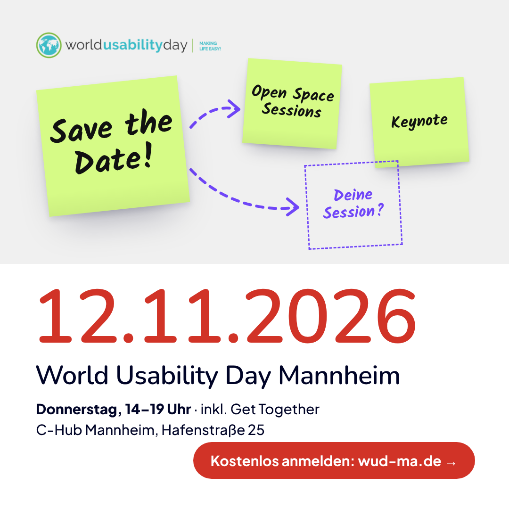
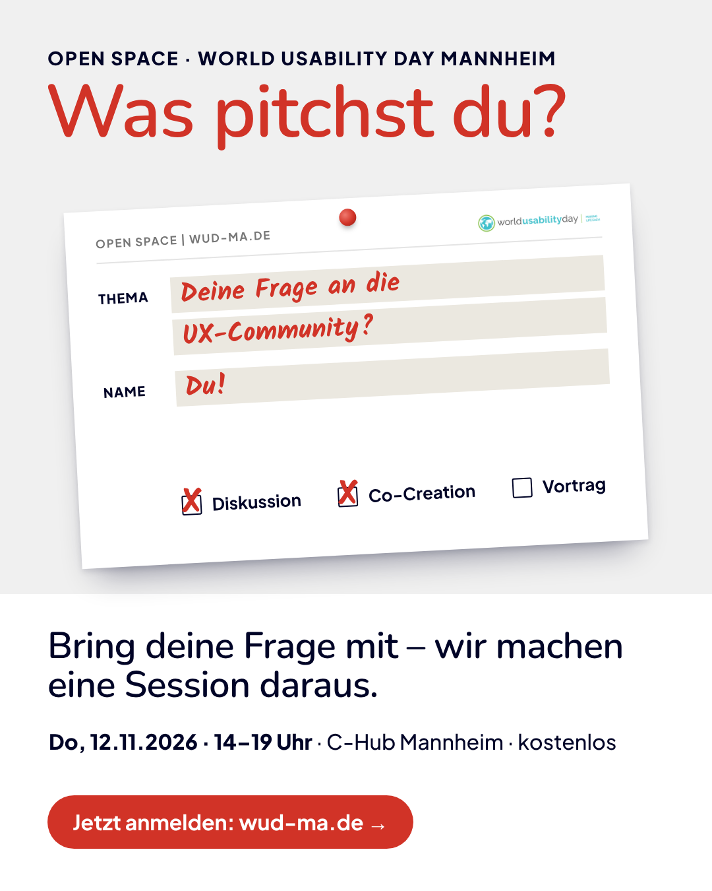
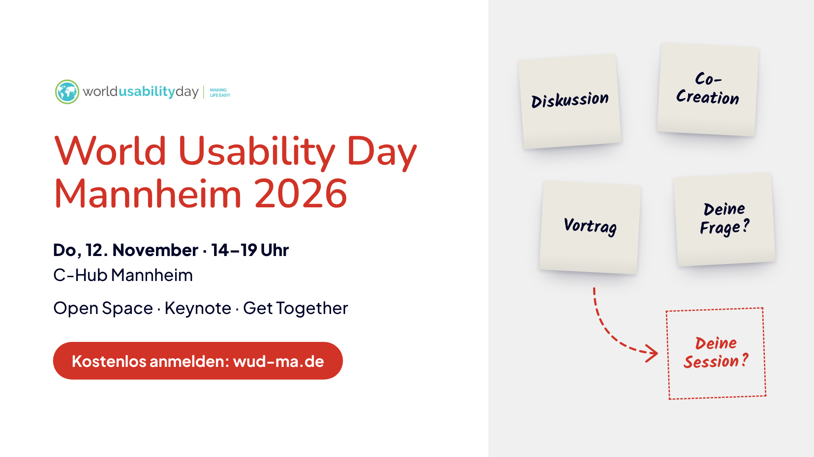

# Marketing-Texte & Posts – Übersicht

## 📱 Posts mit Bild

| Post | Bild | Wann |
|---|---|---|
| **Save the Date** 3 Varianten: kurz, zum Mitgestalten, persönlich → [Texte](save-the-date-linkedin-post.md) |  | ab sofort |
| **Ankündigung** (Orga-Account) + Repost-Text für Teilnehmende → [Texte](event-vorstellung.md#fertige-social-media-posts) |  | ab sofort |
| **Instagram / Kurzformat** → [Text](event-vorstellung.md#instagram--kurzformat) |  | ab sofort |
| **Was pitchst du?** – Motivation für die Sessions 3 Varianten: Themen 2025, persönlich (Ronja), kurz → [Texte](sessions-mitmachen-post.md) |  | Do, 29.10. |
| **Open Space erklärt** → [Text](open-space-format.md#social-post-open-space-erklärt-linkedin-carousel--oder-text-post) |  | Anfang November |
| **Letzte Plätze** → [Text](event-vorstellung.md#letzte-plätze-post-ca-1-woche-vorher-falls-noch-plätze-frei) |  | ca. Do, 05.11. |

**Titelbild für das LinkedIn-Event (16:9):**

## ✍️ Texte zum Einbauen

| Datei | Inhalt |
|---|---|
| [event-vorstellung.md](event-vorstellung.md) | Event-Beschreibung in XS/S/M/L (Kalender, Event-Plattformen, Partner, Presse) |
| [open-space-format.md](open-space-format.md) | Open Space erklärt in XS/S/M/L, Pitch in 3 Sätzen, Tipps für Sessiongebende, FAQ |
