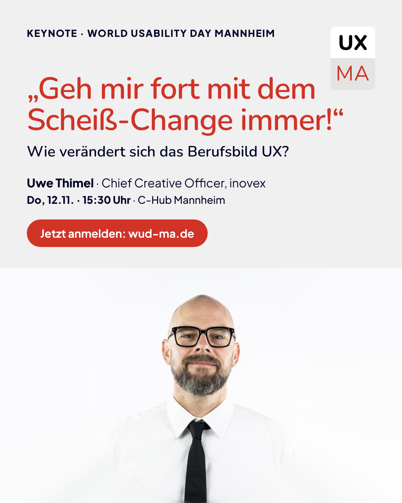
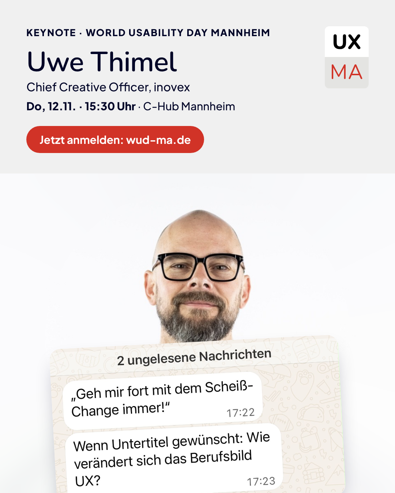
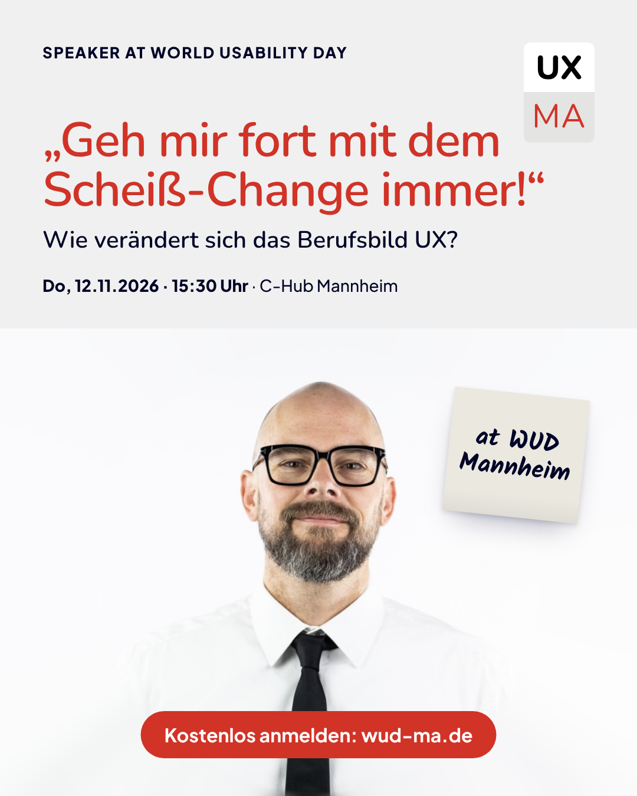
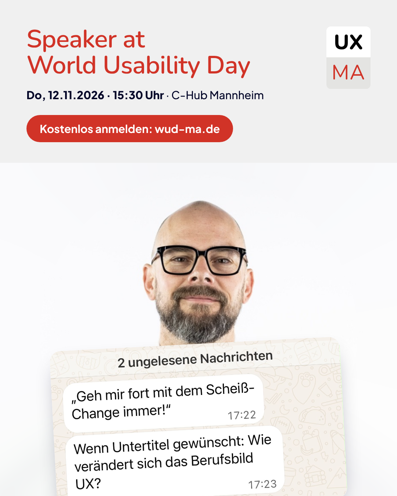

# Keynote-Ankündigung: Uwe Thimel

**Vortrag:** „Geh mir fort mit dem Scheiß-Change immer!“ – Wie verändert sich das Berufsbild UX?

> ⚠️ **Vor dem Veröffentlichen von Uwe freigeben lassen:** Die Bio basiert auf öffentlichen Angaben (u. a. Podcast „Digital Future“ von inovex, Sept. 2025, und Profilseiten) und ist nicht von ihm bestätigt.

**Zwei Grafik-Stile zur Auswahl** (je für euch und zum Teilen für Uwe, jeweils auch in Schwarz-Weiß):

| Klassisch – Titel groß | Chat – echter Screenshot |
|---|---|
|  |  |
|  |  |

**Timing-Vorschlag:** Do, 05.11. (zusammen mit dem 1-Woche-Reminder) – Uwe teilt am selben oder am nächsten Tag.

---

## Speaker-Bio

**Kurz (ca. 200 Zeichen, für Grafiken, Programm, Social)**
Uwe Thimel ist Chief Creative Officer bei inovex in Karlsruhe und beschäftigt sich seit vielen Jahren damit, wie digitale Produkte für Menschen gestaltet werden.

**Mittel (ca. 600 Zeichen, für Website, Newsletter, LinkedIn-Event)**
Uwe Thimel ist Chief Creative Officer bei inovex in Karlsruhe. Zuvor war er unter anderem Executive Creative Director bei EXXETA, Geschäftsführer UX bei CAS Software und Creative Director bei 1&1. Als studierter Architekt bringt er einen besonderen Blick auf Gestaltung mit – und gibt sein Wissen auch als Lehrbeauftragter an der Hochschule Karlsruhe weiter. In seiner Keynote eröffnet er den World Usability Day Mannheim und setzt den Impuls für die Open Space Sessions des Nachmittags.

---

## Post 1 – Ankündigung vom Orga-Account / von euch

🎤 Unsere Keynote steht!

Wir freuen uns riesig, dass **Uwe Thimel** den World Usability Day Mannheim eröffnet. Uwe ist Chief Creative Officer bei inovex und hat die Entwicklung von UX über viele Jahre mitgeprägt – von 1&1 über CAS Software und EXXETA bis heute.

Sein Thema: **„Geh mir fort mit dem Scheiß-Change immer!“**
Wie verändert sich das Berufsbild UX?

Um 15:30 Uhr gibt Uwe den Impuls – danach geht’s in die Open Space Sessions, in denen ihr das Programm selbst gestaltet.

📅 Do, 12.11.2026 · 14–19 Uhr
📍 C-Hub Mannheim
🎟️ kostenlos

👉 Anmeldung: https://wud-ma.de

@Uwe Thimel @inovex
#WUDMannheim #WorldUsabilityDay #UXDesign #Keynote #OpenSpace

---

## Post 2 – Zum Teilen für Uwe (Ich-Perspektive)

**Variante A – kurz**

Am 12. November darf ich die Keynote beim World Usability Day in Mannheim halten. 🎤

Mein Thema: „Geh mir fort mit dem Scheiß-Change immer!“ – Wie verändert sich das Berufsbild UX?

Danach wird’s spannend: Im Open-Space-Format gestaltet die Community den restlichen Nachmittag selbst. Ich freue mich auf viele gute Gespräche – kommt vorbei!

📅 12.11. · 14–19 Uhr · C-Hub Mannheim · kostenlos
👉 https://wud-ma.de

#WUDMannheim #WorldUsabilityDay #UXDesign

**Variante B – etwas persönlicher**

Wie gestalten wir digitale Produkte, die Menschen wirklich weiterbringen? Darüber spreche ich am 12. November in meiner Keynote beim World Usability Day Mannheim.

{{Ein Satz von Uwe, warum ihn das Thema gerade beschäftigt.}}

Was mich an dem Event besonders freut: Nach der Keynote gibt es kein festes Programm, sondern Open Space Sessions – die Themen bringen alle Teilnehmenden selbst mit. Wer also eine Frage hat, die er schon immer mal mit der UX-Community diskutieren wollte: Das ist die Gelegenheit.

Danke an @Christian Fernandez, @Christian Reschke und @Ronja Walter für die Einladung!

📅 Do, 12.11.2026 · 14–19 Uhr · C-Hub Mannheim · kostenlos
👉 https://wud-ma.de

#WUDMannheim #WorldUsabilityDay #UXDesign #Keynote

---

## Baustein für Newsletter & Reminder

**🎤 Keynote: Uwe Thimel**
Um 15:30 Uhr eröffnet Uwe Thimel, Chief Creative Officer bei inovex, den World Usability Day Mannheim mit seiner Keynote **„Geh mir fort mit dem Scheiß-Change immer!“ – Wie verändert sich das Berufsbild UX?**. Danach geht’s direkt in die Open Space Sessions.

## Baustein für die Website (Programmpunkt 15:30 Uhr)

**Keynote & Opening – Uwe Thimel**
„Geh mir fort mit dem Scheiß-Change immer!“ – Wie verändert sich das Berufsbild UX?
Uwe Thimel ist Chief Creative Officer bei inovex in Karlsruhe. Mit seiner Keynote eröffnet er den World Usability Day Mannheim und gibt den Impuls für die Open Space Sessions.

---

## Nachricht an Uwe (zum Mitschicken der Assets)

Hallo Uwe,

wir freuen uns sehr, dass du die Keynote beim World Usability Day Mannheim übernimmst! Damit du die Keynote auch selbst ankündigen kannst, haben wir dir eine Grafik und zwei Textvorschläge vorbereitet:

- Grafik zum Teilen: {{Link zur Grafik}}
- Textvorschläge: {{Link oder Text einfügen}}

Eine kurze Bitte: Schau gern einmal über die Kurz-Bio – stimmt alles so, oder möchtest du etwas ändern?

Wir würden die Ankündigung gern am Donnerstag, 5.11., posten – wenn du am selben Tag oder kurz danach teilst, wäre das super.

Danke dir und bis bald!
Ronja
