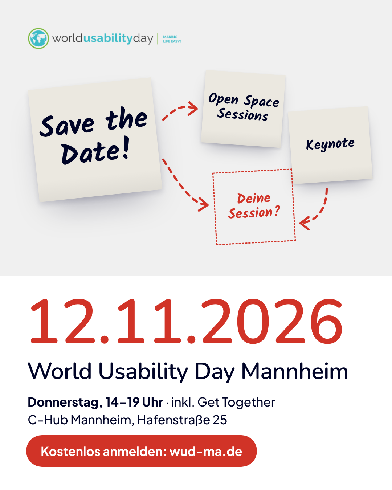

# Save the Date – LinkedIn-Post

**Bild:** [`assets/export/wud-ma-2026_save-the-date_linkedin_1080x1350.png`](../assets/export/wud-ma-2026_save-the-date_linkedin_1080x1350.png) (Hochformat 4:5 – nimmt im Feed am meisten Platz ein)
Alternative: [`…_save-the-date_quadrat_1080x1080.png`](../assets/export/wud-ma-2026_save-the-date_quadrat_1080x1080.png)

**Tipp:** Den Anmeldelink nicht nur in den Post, sondern zusätzlich als ersten Kommentar setzen und das LinkedIn-Event verlinken bzw. teilen.

---

## Variante A – Kurz & knackig

📌 Save the Date: Am 12. November ist World Usability Day in Mannheim!

Wir treffen uns im C-Hub zu Open Space Sessions, einer Keynote und einem entspannten Get Together. Das Programm? Macht ihr. 🙌

📅 Do, 12.11.2026 · 14–19 Uhr
📍 C-Hub Mannheim
🎟️ kostenlos

👉 Anmeldung: https://wud-ma.de

#WUDMannheim #WorldUsabilityDay #UXDesign #OpenSpace #Mannheim

---

## Variante B – Mit Einladung zum Mitgestalten

Save the Date! 🗓️ Der World Usability Day Mannheim ist zurück.

Am 12. November dreht sich im C-Hub alles um User Experience und menschenzentriertes Design – und zwar so, wie die Community es will. Denn bei uns gibt es kein festes Programm: Im Open-Space-Format pitcht ihr eure Themen, und gemeinsam entsteht daraus die Agenda.

Ob KI im Design, Research-Methoden oder Accessibility – welches Thema würdest du mitbringen? Schreib’s in die Kommentare 👇

📅 Donnerstag, 12.11.2026, 14–19 Uhr
📍 C-Hub Mannheim, Hafenstraße 25
🎟️ kostenlos, Plätze begrenzt

Anmeldung: https://wud-ma.de

Wir freuen uns auf euch!
@Christian Fernandez @Christian Reschke @Ronja Walter

#WUDMannheim #WorldUsabilityDay #WUD2026 #UXDesign #UserExperience #OpenSpace #RheinNeckar

---

## Variante C – Persönlich (aus Sicht einer Organisatorin / eines Organisators)

Ich freue mich riesig: Am 12. November organisieren wir wieder den World Usability Day in Mannheim! 🌍

Was ich am Open-Space-Format so mag: Es sind nicht die Speaker:innen, die bestimmen, worüber geredet wird – sondern alle, die da sind. Dadurch entstehen Gespräche, die man auf klassischen Konferenzen selten führt.

Wenn du in der Rhein-Neckar-Region an Produkten arbeitest – egal ob in Design, Research, Produktmanagement oder Entwicklung –, komm vorbei. Und bring deine Fragen mit.

📅 12.11.2026 · 14–19 Uhr · C-Hub Mannheim · kostenlos
👉 https://wud-ma.de

#WUDMannheim #WorldUsabilityDay #UXDesign
